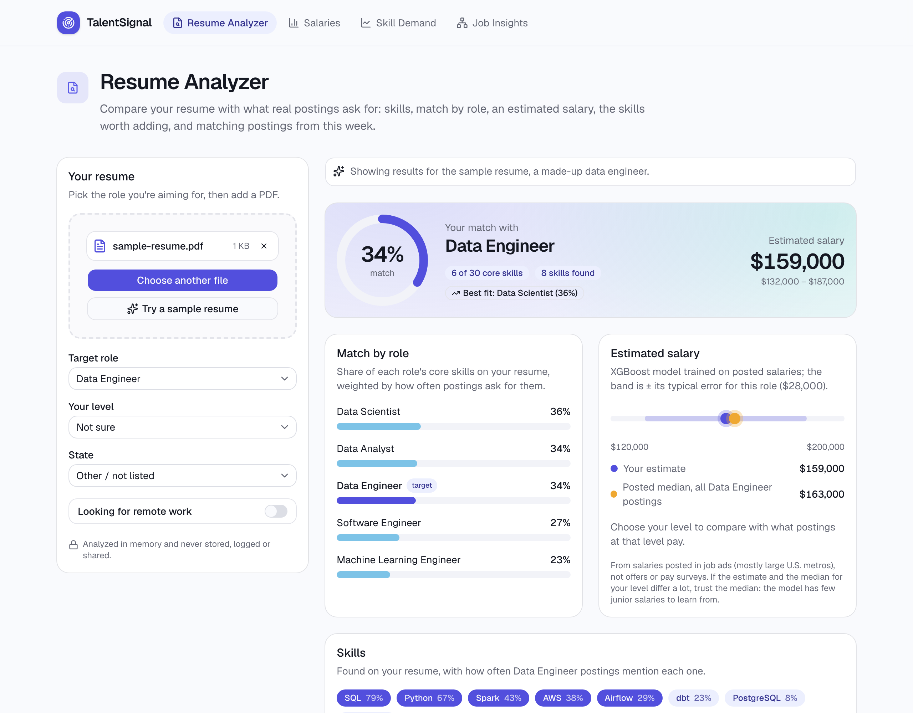
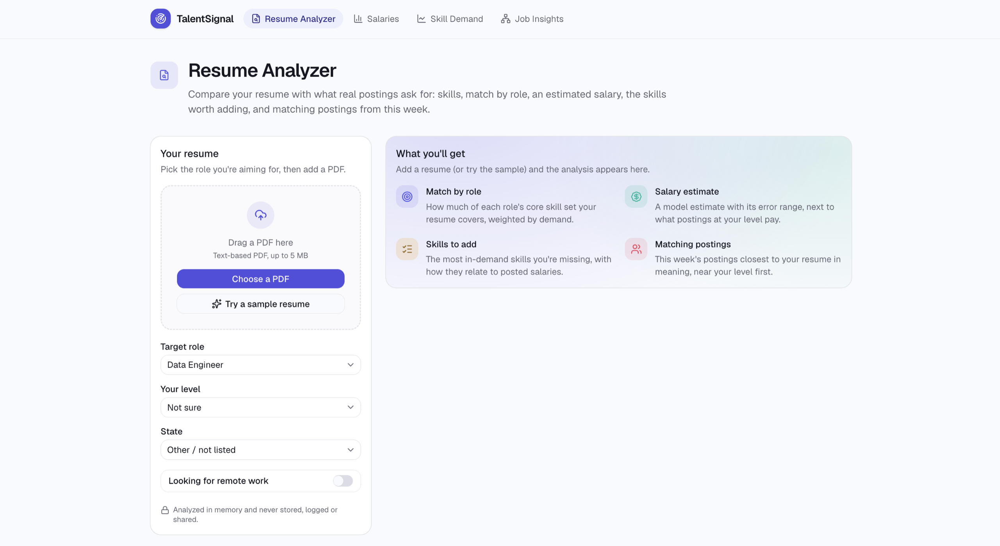
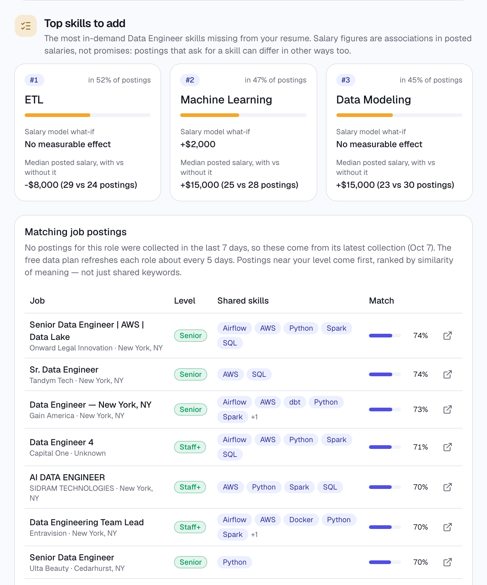
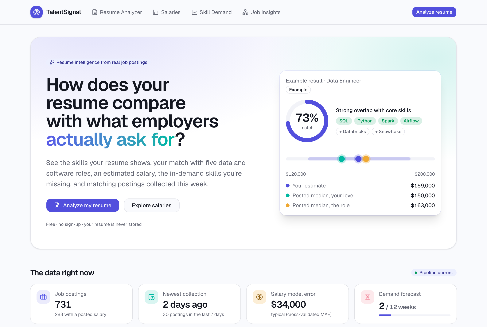
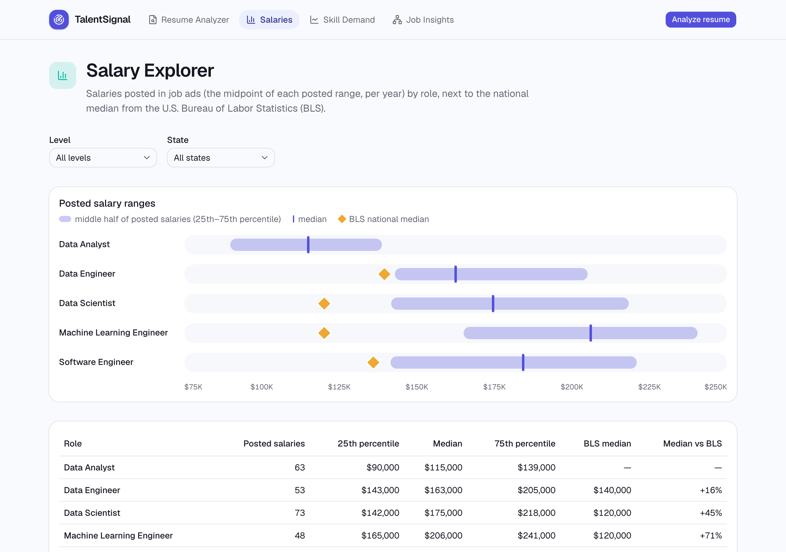
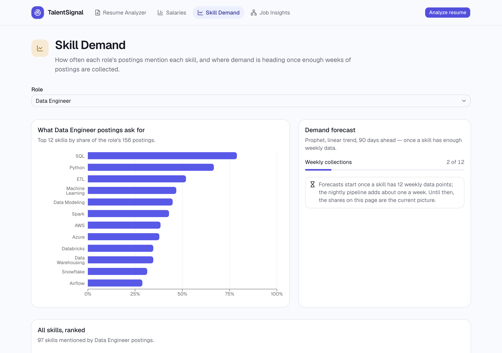
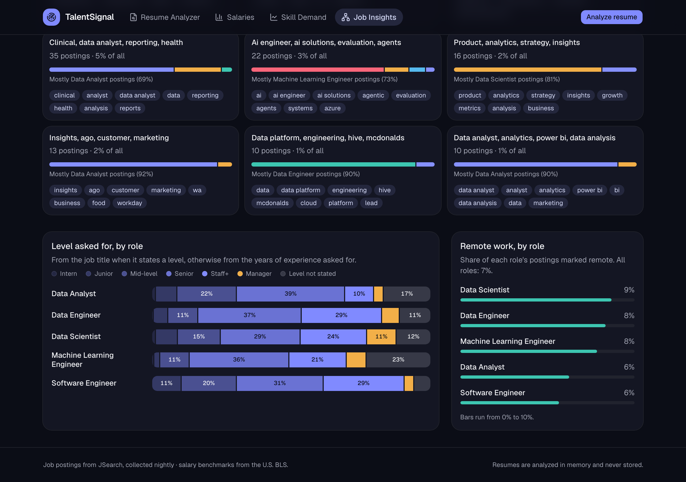
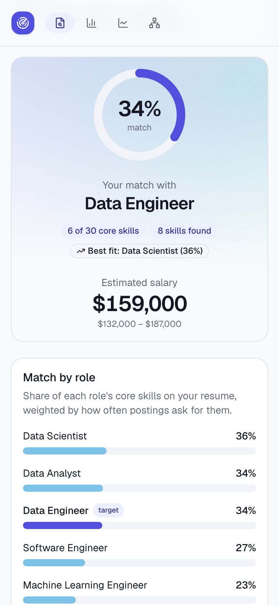
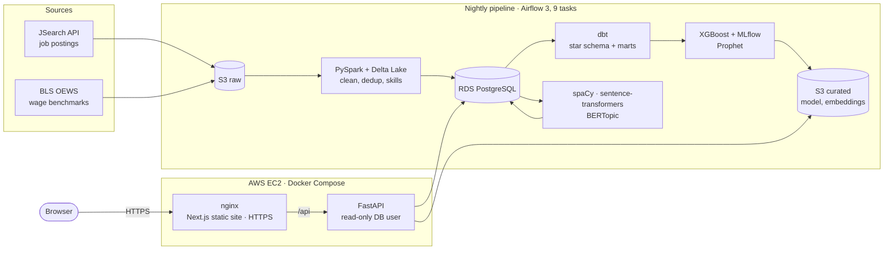
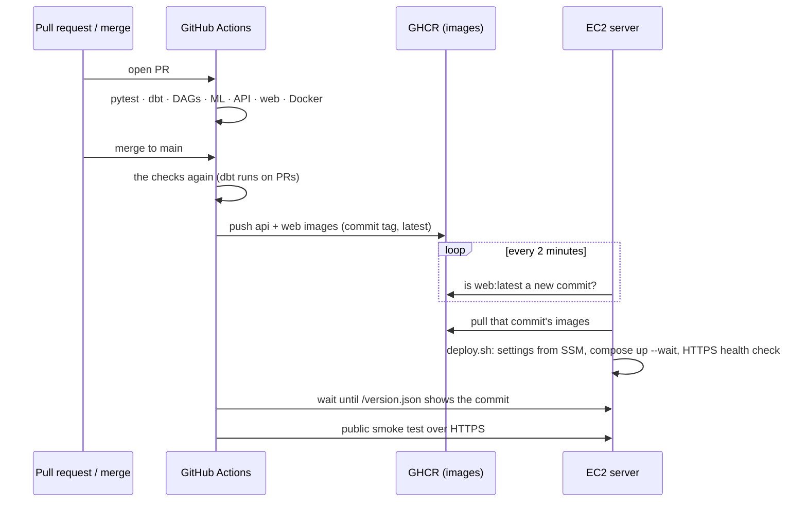

# TalentSignal

**How does your resume compare with what employers actually ask for?**

TalentSignal collects real job postings every night, turns them into skill-demand and
salary data, and uses it to read a resume: the skills it shows, how well it matches five
data and software roles, an estimated salary, the in-demand skills it's missing, and the
postings it fits best.

[](https://github.com/Ashup1101/talentsignal/actions/workflows/ci.yml)
&nbsp;**Showcase: <https://ashup1101.github.io/talentsignal/>**



> **Live app paused.** The EC2 instance and the database are stopped to save costs; the
> data, models and deployment are intact. To restart it, see
> [Restarting the live app](#restarting-the-live-app). Screenshots below use the built-in
> made-up sample resume. Resumes are read in memory and never stored, logged or shared.

---

## Contents

- [What it does](#what-it-does)
- [Screenshots](#screenshots)
- [How it works](#how-it-works)
- [CI/CD and deployment](#cicd-and-deployment)
- [Results, measured](#results-measured)
- [The learning journey](#the-learning-journey)
- [Run it yourself](#run-it-yourself)

## What it does

| | |
|---|---|
| **Resume Analyzer** | Upload a PDF → skills found (the same skill dictionary the pipeline uses on postings, no LLM), match % for each role, an XGBoost salary estimate next to what postings at your level pay, the three most in-demand skills you're missing, and the postings closest in meaning to your resume. |
| **Salary Explorer** | Posted salary ranges by role, level and state, next to the U.S. Bureau of Labor Statistics national medians. |
| **Skill Demand** | What each role's postings ask for, ranked, and progress toward the demand forecast. |
| **Job Insights** | Topics found in the postings (BERTopic), which roles they come from, levels asked for and remote share. |

Postings come from five roles (data analyst, data engineer, data scientist, machine
learning engineer, software engineer) in five metros (New York, San Francisco, Seattle,
Austin, Chicago).

## Screenshots

| First visit | Skills to add + matching postings |
|---|---|
|  |  |
| **Home** | **Salary Explorer** |
|  |  |
| **Skill Demand** | **Job Insights (dark mode)** |
|  |  |

<p align="center">
  <br>
  <em>On a phone</em>
</p>

## How it works



**Data pipeline** (runs nightly on a laptop with Airflow 3)
- **Ingestion:** JSearch postings and BLS wage data land as raw JSON in S3. A hard monthly
  budget and a least-recently-fetched rotation keep it inside the free API plan (~200
  requests/month).
- **PySpark + Delta Lake:** flatten, normalize (salaries annualized, states coded),
  deduplicate across collections, extract ~110 skills with a shared dictionary (pandas UDF).
- **dbt on RDS PostgreSQL:** a star schema (`dim_role`, `dim_location`, `fact_job_postings`)
  plus trend, salary-band and skill-demand marts: 19 models, 86 data tests.
- **NLP + ML:** years of experience from spaCy rules, posting embeddings
  (all-MiniLM-L6-v2), BERTopic topics, an XGBoost salary model tracked in MLflow, and a
  Prophet demand forecast that waits until each series has 12 weekly points.

**App**
- **Next.js** (React, TypeScript, Tailwind, shadcn/ui, Recharts) exported as static
  files: no Node process on the server. Types are generated from the API's OpenAPI spec,
  so the frontend can't drift from the API.
- **FastAPI** reads the dbt marts as a read-only database user and loads the model and
  embeddings from S3. The resume is embedded with the same model as the postings and
  matched by cosine similarity.
- **Privacy by design:** the PDF is sent as a raw body (no multipart temp files), nginx
  keeps it in memory instead of spilling it to disk, nothing is logged, and scanned PDFs
  get a clear "no text" message instead of an empty analysis.

## CI/CD and deployment

Every pull request runs seven checks; merging to `main` publishes the images and the
server deploys them itself.



| CI job | What it proves |
|---|---|
| pytest | Ingestion, Spark jobs (local SparkSession), skill dictionary, scripts |
| dbt build | Every model and test against a throwaway Postgres loaded with a real 50-posting sample |
| DAG tests | Both Airflow DAGs import and keep their task order (Airflow installed with its constraints) |
| ML tests | NLP, embeddings, topics, salary model, forecast, resume parsing (CPU-only PyTorch) |
| API tests | Every endpoint and error code, with exactly the server's locked dependencies |
| Web | Lint, type-check, generated API types current, Vitest, static build |
| Docker build | Both images build; the API image works offline; nginx's HTTP and HTTPS modes |
| Publish *(main)* | Images pushed to GHCR and pullable anonymously |
| Release *(main)* | The live site serves the new commit, then the public smoke test passes |

**Deployment, step by step**
1. **Server:** an EC2 t3.small (Amazon Linux 2023) created by scripts in `infra/aws/`:
   ports 80 and 443 only (**no SSH port**), an IAM role that can read only the model files
   and the app's settings, IMDSv2, 2 GB swap. Settings live in SSM Parameter Store, not in
   files.
2. **Containers:** Docker Compose runs the API and nginx. The API image pins
   `OMP_NUM_THREADS=1` and bakes in the embedding model, so it starts offline.
3. **HTTPS:** a Let's Encrypt certificate for `<server-ip>.sslip.io` (sslip.io maps the
   name to the IP, so no domain purchase), issued by certbot in a container; a systemd
   timer checks it for renewal twice a day. nginx switches itself from HTTP to HTTPS once the
   certificate exists.
4. **Continuous deployment:** a systemd timer runs `update.sh` every 2 minutes. When CI
   has published a new commit, it runs `deploy.sh` for it: settings from Parameter Store,
   that commit's images, `docker compose up --wait`, an HTTPS health check, and only then
   records the commit as deployed. A failed commit isn't retried until a newer one
   arrives.
5. **Verification:** CI waits for the live `/version.json` to show its commit and runs a
   public smoke test (certificate, redirect, HSTS, pages, database, the sample resume end
   to end). A typical deploy is live about a minute after the images are published. While
   the app is paused, the repository variable `APP_HOST` is unset and this job is skipped.

Why the server *pulls* instead of CI pushing: the AWS account belongs to an AWS
Organization whose policy forbids creating the GitHub OIDC identity provider. Rather than
store long-lived AWS keys in GitHub, the server watches the registry. The result is the
same hands-off pipeline, with **no AWS credentials in CI at all**.

## Results, measured

Targets came from the original project description; these are the real numbers (as of
the 20 Oct 2026 pipeline run).

| What | Result |
|---|---|
| Postings | **869** unique postings (333 with a salary) across 5 roles × 5 metros (target was 50K+; the free API plan allows ~200 requests a month) |
| Deduplication | JSearch issues a new id for the same posting on every collection (0 repeats in 728 sightings), so dedup is by normalized title + employer + city |
| Experience extraction | 74% of postings state years of experience; "level unknown" fell from 43% to 14% |
| Topics | 9 BERTopic topics, stable across reruns on the same data; about half the postings stay unassigned rather than forced into a topic |
| Salary model (XGBoost) | Cross-validated error **$35.7K** (5 folds grouped by employer): 20% lower than the role median ($44.4K), 9% lower than role × seniority ($39.1K), vs $50.5K global median. Target was < $9K: missed, with 333 salaried postings |
| Demand forecast (Prophet) | Built and tested; waiting for 12 weekly collections before it forecasts anything (3 so far) |
| Pipeline | 9 Airflow tasks in about 3½ minutes |
| App | A resume analysis takes about 1 second; the API uses ~0.6–0.8 GB of the server's 2 GB |
| Cost | Running: EC2 + disk + IP ≈ $20/month, RDS ≈ $18/month. Paused: about $4/month (disks and S3) |

## The learning journey

I rebuilt this project from a one-paragraph resume description, one phase at a time,
writing down every decision and measuring every number. What each phase taught me:

**1. Ingestion: respect the API.** JSearch's free plan is 200 requests a month, so the
fetcher plans its own budget: a share per day, a rotation so every role is sampled weekly,
and a hard stop based on the API's own "requests remaining" header. BLS blocks anonymous
scripts, so requests carry a contact address.

**2. PySpark: duplicates hide.** The same posting came back with a new id on every
collection: 0 repeated ids in 728 sightings. Deduplication had to use what a posting *is*
(title, employer, city), and missing locations are left empty rather than guessed from
the search.

**3. dbt: averages lie about causes.** Postings mentioning Excel paid $65K less than those
that didn't, but mostly because analysts mention Excel. Every "salary impact" in the app
compares within one role and is worded as an association, never a promise.

**4. Airflow: the boring details matter.** Airflow 2 reached end of life, so it's Airflow
3, installed without Docker. Unpausing a DAG immediately runs its last missed slot, and a
Mac that sleeps after a minute stalls a nightly run.

**5. NLP + ML: measure before trusting.** 93% of descriptions were longer than the
embedding model reads, so text is chunked and averaged. Shared legal boilerplate (22 postings
from one employer with the same legal text) was forming its own "topic", so sentences used across
many job titles are removed first. The salary model beats every baseline but misses its
target, and the app says so. PyTorch and XGBoost crashed the process together (two OpenMP
runtimes), fixed by pinning `OMP_NUM_THREADS=1` and guarded by a regression test.

**6. The app: real users find real problems.** I started with Streamlit, tried it with my
own resumes, and pivoted to Next.js + FastAPI for a better product. Testing on real
resumes surfaced issues: junior salaries read high (the page now shows what postings at
your level pay), matches ignored seniority (now ranked by level first), and small samples
swung salary differences by ±$33K (now hidden below 10 postings per side).

**7. Shipping: production pushes back.**
- The "existing Elastic IP" in the account turned out to be the database's public
  address; moving it would have taken the pipeline down.
- The AWS Organization's policy blocked GitHub OIDC, which led to the pull-based deploy
  above.
- nginx writes request bodies over 16 KB to a temp file by default, which is wrong for
  resumes, so it now keeps them in memory.
- CI once failed on `main` because nginx was checked before it had finished starting;
  the image now has a real health check.
- Locally, Docker (Colima) hung on start because the Mac's SSH agent never answered.

Each of these became a fix plus a test that keeps it fixed.

## Run it yourself

<details>
<summary><b>Local setup</b> (Python 3.11, Java 17 for Spark)</summary>

On macOS, XGBoost also needs OpenMP: `brew install libomp`.

```bash
python3.11 -m venv .venv
source .venv/bin/activate
pip install -r requirements-ml.txt   # pipeline + dev + ML (~2.6 GB)
# create .env with the API keys, AWS, RDS and Databricks settings (never committed)
pytest
```

`requirements-dev.txt` (no ML) is what the CI `pytest` job installs; ML tests run in their
own job. Dependencies are declared in `pyproject.toml` and pinned with pip-tools.
</details>

<details>
<summary><b>Pipeline</b>: ingestion, Spark, Airflow</summary>

```bash
python -m src.ingestion.fetch_jobs --dry-run   # what tonight's run would fetch, no API calls
python -m src.ingestion.fetch_jobs             # s3://$S3_RAW_BUCKET/jobs/raw/{role}/{location}/{date}.json
python -m src.ingestion.fetch_bls              # s3://$S3_RAW_BUCKET/bls/raw/{date}.json

python -m src.processing.clean_jobs            # → delta/jobs_clean (+ job_sightings)
python -m src.processing.extract_skills        # → delta/job_skills
python -m src.processing.clean_bls             # → delta/bls_occupations

infra/airflow/install.sh                       # once: Airflow 3 in .venv-airflow
infra/airflow/run_local.sh                     # UI at http://localhost:8080
```

`talentsignal_pipeline` (daily, 22:00 UTC): fetch_jobs → clean_jobs → extract_skills →
load_postgres → nlp_enrich → dbt_source_freshness → dbt_build → train_salary_model and
forecast_demand in parallel. Every step rebuilds its output, so reruns are safe.
</details>

<details>
<summary><b>App</b>: locally and on the server</summary>

```bash
infra/docker/run_local.sh       # API + nginx in Docker at http://localhost/
# or without Docker:
infra/api/run_local.sh          # API on :8000 (docs at /api/docs)
cd web && npm run dev           # frontend on :3000
```

The server was created with `infra/aws/create_server.sh`, `put_app_params.sh` and
`verify_server.sh`, using temporary console credentials (`aws login`). While it runs,
deploys need nothing by hand.
</details>

### Restarting the live app

The app is paused: EC2 and RDS are stopped, not deleted, and the server's Elastic IP was
released (an unattached public IP is billed). Everything else (the disk, settings in
Parameter Store, images in GHCR, S3 data) is kept. To bring it back:

```bash
aws login --profile ts-admin --region us-east-2
export AWS_PROFILE=ts-admin AWS_REGION=us-east-2
aws rds start-db-instance --db-instance-identifier talentsignal-db
aws ec2 start-instances --instance-ids i-0b5ccbfa127db4eb2
aws rds wait db-instance-available --db-instance-identifier talentsignal-db

infra/aws/create_server.sh      # reuses everything; attaches a new Elastic IP (new hostname)
gh variable set APP_HOST --body "<new-ip-with-dashes>.sslip.io"   # turns the CI release job back on
infra/deploy/run_remote.sh i-0b5ccbfa127db4eb2 "$(git rev-parse origin/main)"   # new certificate on first deploy
infra/deploy/smoke_test.sh "<new-ip-with-dashes>.sslip.io"
```

AWS restarts a stopped RDS instance by itself after 7 days, so stop it again if the
pause lasts longer.

## Repository layout

```
src/ingestion    JSearch + BLS → S3          src/api       FastAPI: endpoints, logic, serving
src/processing   PySpark jobs, Postgres load  web/          Next.js frontend (static export)
src/dbt_project  dbt models, tests, CI data   infra/aws     EC2, IAM, Parameter Store scripts
src/dags         Airflow DAGs                 infra/docker  Images, nginx, local compose
src/skills       Shared skill dictionary      infra/deploy  deploy.sh, update.sh, smoke test
src/ml           NLP, salary model, forecast  tests/        pytest suites (+ Vitest in web/)
```
